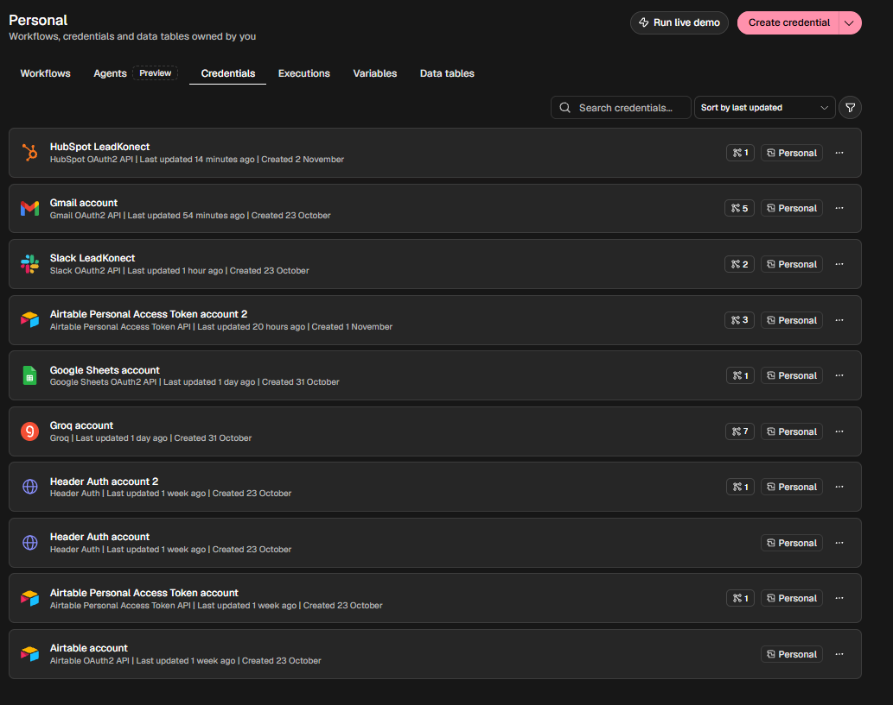
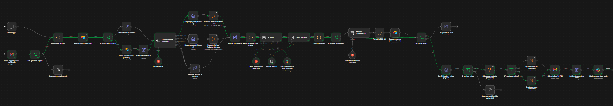
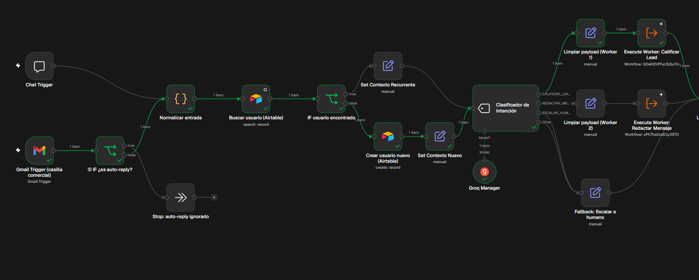
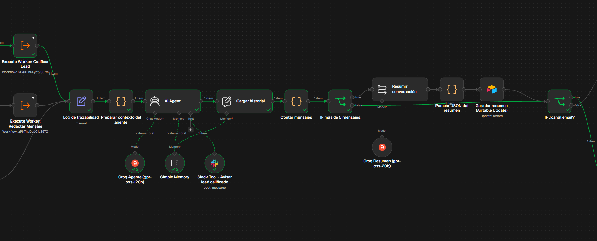
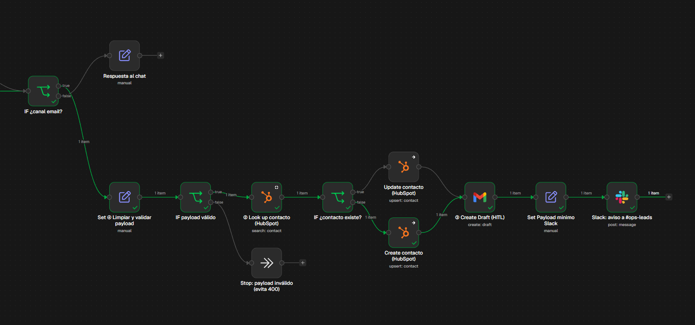
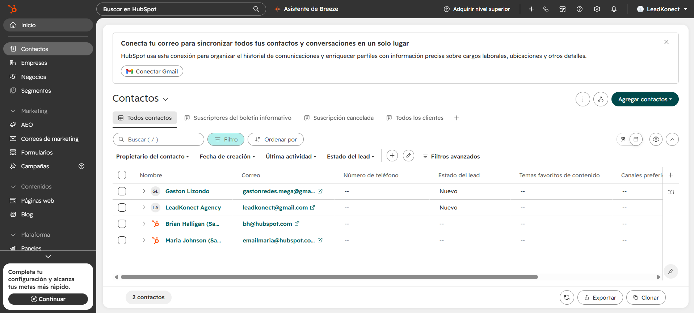
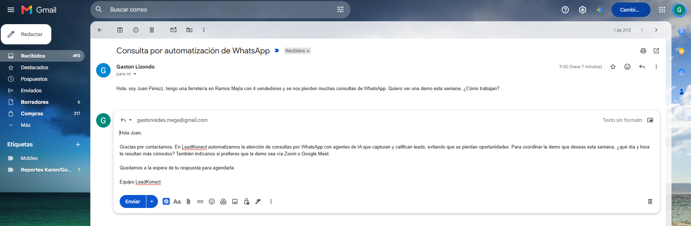
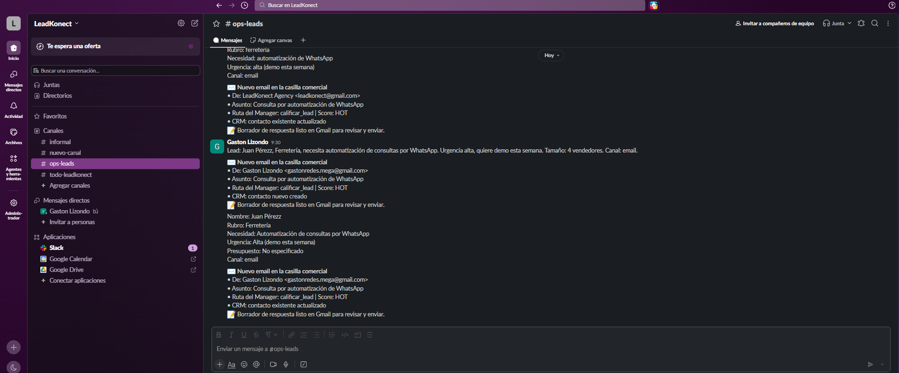
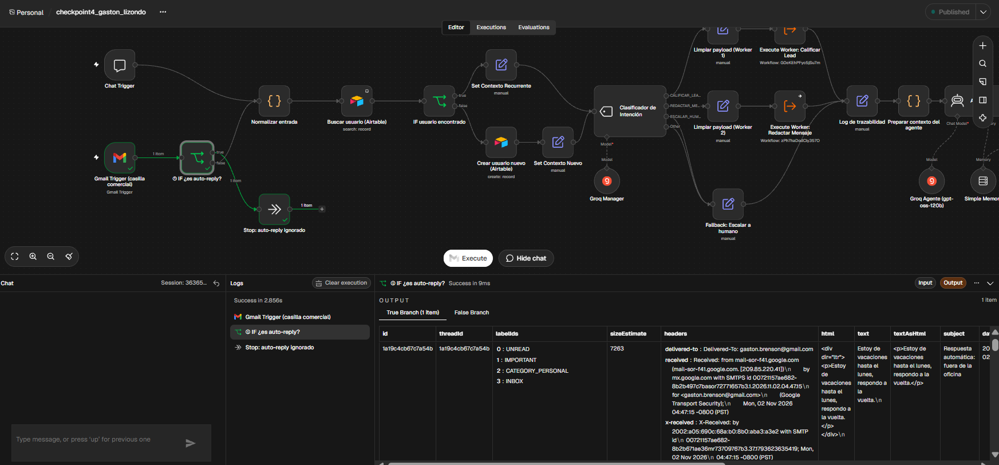
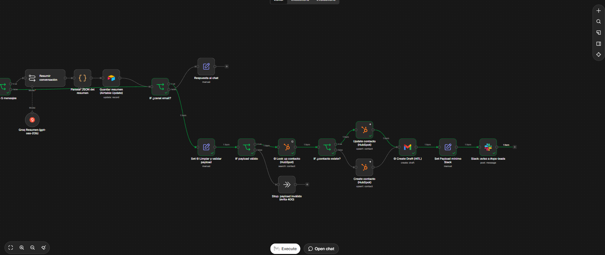

# Checkpoint 4 · Integraciones Avanzadas e Interconexión de Sistemas

**Alumno:** Gastón Lizondo · **Curso:** AI Automation Avanzado · **Proyecto integrador:** Agente comercial de LeadKonect

Archivo del workflow: [`checkpoint4_gaston_lizondo.json`](./checkpoint4_gaston_lizondo.json) (exportado desde n8n con *Workflow → Download*, se importa con *Import from File*).

---

## 1. Conexiones activas (OAuth2)



| Rol en el ecosistema (clase en vivo) | Herramienta | Autenticación | Uso en el flujo |
|---|---|---|---|
| CRM / fuente única de verdad del cliente | **HubSpot** | OAuth2 | Look up, Update y Create de contactos |
| Casilla de soporte / comercial | **Gmail** | OAuth2 | Trigger de entrada + Create Draft |
| Canal del equipo de operaciones | **Slack** | OAuth2 | Aviso a `#ops-leads` + herramienta del agente |
| Memoria del agente (M3) | Airtable | Personal Access Token | Leer / escribir contexto por Session_ID |
| Modelos (M1–M3) | Groq (`gpt-oss-120b` / `gpt-oss-20b`) | API key | Clasificador, agente y resumen |

## 2. Cómo evolucionó el proyecto

```
M1 · Agente base        Chat Trigger → AI Agent (Tools Agent) + System Prompt + Tool + Log
M2 · Multi-agente       Manager → Clasificador → Workers (sub-workflows) con contrato JSON
M3 · Memoria            Airtable por Session_ID + resumen JSON cuando hay más de 5 mensajes
M4 · Integraciones      + Gmail (entrada y borrador) + HubSpot (CRM) + Slack (operaciones)   ← este checkpoint
```

No se rehízo nada: se importó el JSON del M3 y se le sumó una segunda puerta de entrada (email) y una salida hacia el ecosistema del negocio. El canal de chat sigue funcionando igual que antes.

## 3. Arquitectura del workflow

```
[Chat Trigger] ─────────────────────────────────────┐
                                                    ▼
[Gmail Trigger] → ① [IF ¿es auto-reply?] ──No──▶ [Normalizar entrada]   (canal, Session_ID = email, texto limpio)
                        │ Sí                         │
                        ▼                            ▼
              (Stop: corta el bucle)   ── flujo M3: Airtable → Clasificador → Workers → AI Agent → Resumen ──
                                                     │
                                            [IF ¿canal email?]
                                  chat ◄────────────┘   └────────────► email
                          [Respuesta al chat]                ▼
                                            ④ [Set: limpiar y validar payload] → [IF payload válido] ──No──▶ Stop (evita 400)
                                                             │ Sí
                                                             ▼
                                            ② [Look up contacto en HubSpot]
                                                  ┌──────────┴──────────┐
                                                existe              no existe
                                            [Update contacto]   [Create contacto]   (evita el 409)
                                                  └──────────┬──────────┘
                                                             ▼
                                            ③ [Gmail: Create Draft]   (Human-in-the-loop: no se envía nada)
                                                             ▼
                                            [Set: payload mínimo Slack] → [Slack: aviso a #ops-leads]
```

## 4. Los 4 nodos clave de la rúbrica

### ① IF anti auto-reply — corta el bucle infinito
Ubicado **inmediatamente después del Gmail Trigger**. Evalúa tres condiciones en **OR** (sin distinguir mayúsculas):

- **Asunto** contiene: `auto-reply`, `automatic reply`, `respuesta automática`, `out of office`, `fuera de la oficina`, `undeliverable`, `delivery status notification`, `mail delivery failed`.
- **Remitente** contiene: `no-reply`, `noreply`, `do-not-reply`, `mailer-daemon`, `postmaster`.
- **Encabezados técnicos**: `Auto-Submitted: auto-…`, `Precedence: bulk/junk/auto_reply`, `X-Autoreply`.

Si alguna se cumple, el correo termina en *Stop: auto-reply ignorado* y no consume tokens ni toca el CRM. Además, el trigger filtra `-from:me`, y el agente ya **no envía emails** (la herramienta de Gmail del M1–M3 se reemplazó por una de Slack), así que el flujo no puede dispararse con sus propios mensajes.

### ② Look up antes del Create — evita el Error 409
*Look up contacto (HubSpot)* busca por `email = valor exacto` antes de escribir. El IF siguiente decide:

- **Existe** → *Update contacto*: solo actualiza la nota de último contacto. No pisa el nombre, la etapa ni el estado del lead.
- **No existe** → *Create contacto*: crea el contacto con nombre, apellido, `lifecyclestage = lead` y `hs_lead_status = NEW`.

Así nunca se intenta crear un contacto con un email que ya está en el CRM, que es exactamente lo que dispara el `409 Conflict` en la API de HubSpot.

### ③ Create Draft — guardrail Human-in-the-loop
La salida de correo usa **únicamente la operación *Draft → Create***, dentro del mismo hilo (`threadId`) y dirigida al remitente. La respuesta de la IA queda en *Borradores* y una persona la revisa y la envía. El System Prompt también le prohíbe al agente decir que el mensaje fue enviado.

### ④ Set de limpieza de payload — evita el Error 400
*Set ④ Limpiar y validar payload* descarta todo lo que trae el email (HTML, adjuntos, encabezados, metadatos) y deja solo: `email`, `nombre`, `apellido`, `asunto`, `thread_id`, `respuesta_ia`, `ruta` y `score`, con límites de longitud. Después, *IF payload válido* verifica que el email no esté vacío, que tenga formato válido y que exista una respuesta. Si falla, corta antes de llamar a HubSpot, así nunca se manda un payload mal formado.

Antes de Slack hay un segundo Set (*Payload mínimo Slack*) que arma **un único campo de texto** con remitente, asunto, ruta, score y estado del CRM. Al canal nunca llega el cuerpo del email ni ningún binario.

## 5. Mínimo privilegio

| Conector | Lectura (pasado) | Escritura (futuro) | Lo que **no** hace |
|---|---|---|---|
| HubSpot | Buscar contacto por email (5 propiedades) | Crear / actualizar contacto | No toca deals, empresas, tickets ni borra registros |
| Gmail | Leer correos no leídos de la bandeja de entrada | Crear borradores | No envía, no borra, no reenvía, no lee adjuntos |
| Slack | — | Publicar en `#ops-leads` | No lee mensajes, no publica en otros canales, sin link al workflow |

Las credenciales se autorizan por OAuth2 desde n8n Cloud. Los permisos se acotan además **a nivel operación**: cada nodo usa solo la operación y los campos que su función necesita.

## 6. Contrato de datos del canal email

Lo que sale de *Normalizar entrada* y recorre el flujo (mismo formato para chat y email):

```json
{
  "canal": "email",
  "sessionId": "juan.perez@gmail.com",
  "chatInput": "Asunto: Consulta automatización\n\nHola, tengo una ferretería con 3 vendedores...",
  "from_email": "juan.perez@gmail.com",
  "from_name": "Juan Pérez",
  "subject": "Consulta automatización",
  "message_id": "18f2c...",
  "thread_id": "18f2c..."
}
```

Usar el email del remitente como `Session_ID` conecta este módulo con la memoria del M3: si la misma persona vuelve a escribir, el agente la reconoce y retoma desde su último resumen.

## 7. Test de regresión

| Caso | Entrada | Resultado esperado |
|---|---|---|
| A · Email normal (lead nuevo) | Email desde una casilla externa con una consulta comercial | Pasa el IF ①, recorre el flujo M3, crea el contacto en HubSpot, deja un borrador en Gmail y avisa en Slack |
| B · Auto-reply | Email con asunto "Respuesta automática: fuera de la oficina" | Termina en *Stop: auto-reply ignorado*. Sin CRM, sin borrador, sin Slack |
| C · Contacto repetido | Segundo email desde la misma casilla del caso A | El Look up encuentra el contacto y va por *Update* (no por Create). No se duplica en HubSpot, y el agente retoma el contexto de la memoria |

Las tres pruebas se ejecutaron con éxito.

### Prueba A · Email normal (lead nuevo)

Recorrido completo en verde, del Gmail Trigger al aviso de Slack, pasando por *Create contacto*:



El mismo recorrido en detalle (entrada y memoria, Manager y agente, salida al ecosistema):





Contacto nuevo creado en HubSpot:



Borrador de respuesta en Gmail, dentro del mismo hilo y sin enviar (Human-in-the-loop):



Aviso en `#ops-leads` con el payload mínimo:



### Prueba B · Auto-reply

La ejecución se corta en ① por la rama **true** y termina en *Stop: auto-reply ignorado*:



### Prueba C · Contacto repetido

El Look up encuentra el contacto y el flujo va por **Update contacto**, sin duplicarlo:



## 8. Ajustes surgidos del test

- **Expresión del aviso de Slack:** la primera corrida por *Create contacto* falló con `no_text`, porque el texto consultaba la salida *true* de un IF que en ese camino estaba vacía. Se corrigió leyendo el resultado del Look up, y se agregó un texto de respaldo en el nodo de Slack.
- **Límite de tokens de Groq (429):** el tier gratuito permite 8.000 tokens por minuto por modelo. El clasificador pasó a `gpt-oss-20b` para repartir la carga, y el AI Agent tiene *Retry On Fail* (3 intentos, 5 s entre cada uno).
